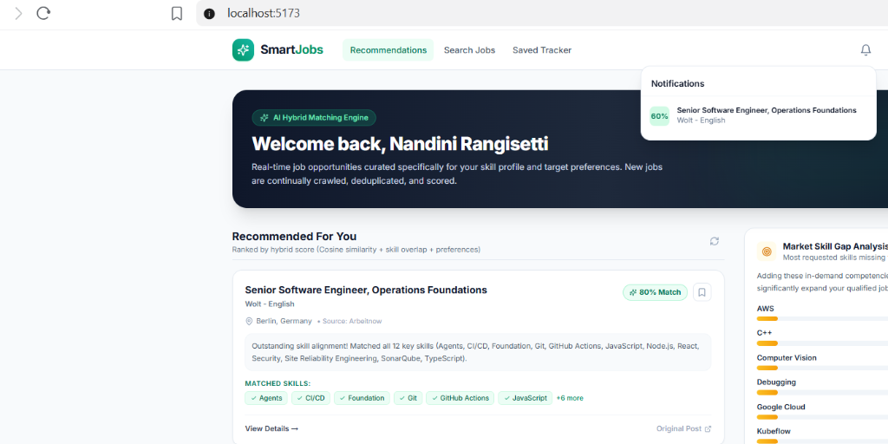
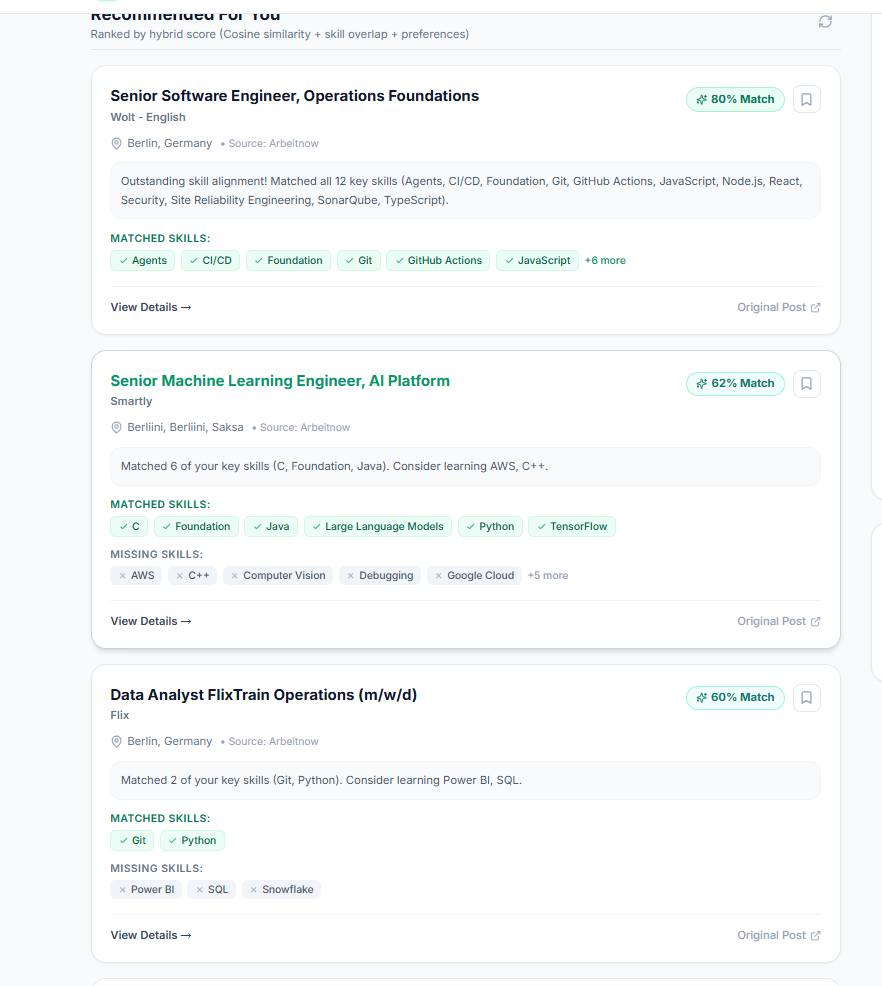
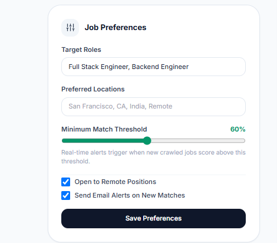
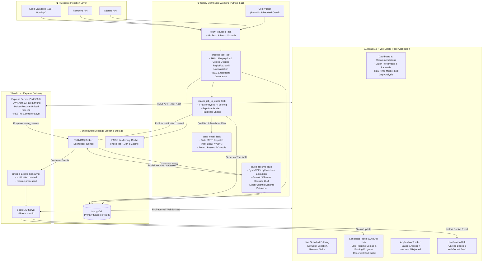

# 🚀 SmartJobs: Real-Time AI Job Aggregator & Recommendation Engine

[](https://react.dev/)
[](https://nodejs.org/)
[](https://expressjs.com/)
[](https://www.python.org/)
[](https://docs.celeryq.dev/)
[](https://www.rabbitmq.com/)
[](https://www.mongodb.com/)
[](https://tailwindcss.com/)
[](https://vitejs.dev/)
[](https://socket.io/)
[](https://www.docker.com/)

**SmartJobs** is a distributed, production-ready AI job intelligence platform. It aggregates live technical postings from diverse sources, normalizes and deduplicates them using cryptographic fingerprints and dense vector embeddings, extracts candidate resumes into strict Pydantic schemas, and delivers real-time personalized recommendations with explainability, skill-gap analysis, instant WebSocket alerts, and rate-limited email notifications.

---

## 📸 Screenshots & Showcase

| AI Match Dashboard & Real-Time Notification Bell | Ranked Recommendations & Explainability |
| :---: | :---: |
|  |  |

| User Preferences & Threshold Control |
| :---: |
|  |

---

## 🏗️ System Architecture



---

## ✨ Key Features

### 1. 🤖 Multi-Tier Resume Parsing & Normalization
- Accepts `.pdf` and `.docx` candidate resumes.
- Text extracted via **PyMuPDF (`fitz`)** and **`python-docx`** without external OS dependencies.
- Structured candidate data (`skills`, `experience`, `projects`, `education`) extracted using strict **Pydantic schemas** with automatic JSON-repair retry loops and deterministic offline regex fallbacks.
- **431+ Canonical Tech Skills** dictionary normalized via **RapidFuzz** fuzzy token ratio matching (e.g., `k8s` → `Kubernetes`, `reactjs` → `React`).

### 2. 🎯 Explainable 4-Factor Hybrid Recommendation Engine
Rather than relying purely on simple keyword matching or raw vector distance, candidate-job alignment is scored using a multi-factor formula:

$$\text{Final Score} = 0.50 \cdot S_{\text{cosine}} + 0.30 \cdot S_{\text{skills}} + 0.10 \cdot S_{\text{location}} + 0.10 \cdot S_{\text{recency}}$$

- **Dense Vector Cosine Similarity ($S_{\text{cosine}}$):** `BAAI/bge-small-en-v1.5` embeddings (384 dimensions) with asymmetric search query prefixes, evaluated via **FAISS `IndexFlatIP`**.
- **Skill Overlap Ratio ($S_{\text{skills}}$):** Exact canonical overlap $\frac{|\text{User Skills} \cap \text{Job Skills}|}{|\text{Job Skills}|}$.
- **Location & Remote Preference ($S_{\text{location}}$):** Weighted matching for remote flexibility and target geographic markets.
- **Recency Decay ($S_{\text{recency}}$):** Exponential decay $e^{-\ln(2) \cdot \frac{\text{Days Ago}}{14}}$ (14-day half-life).
- **Explainability:** Generates human-readable match explanations (e.g., *"Matched all 12 key skills including Node.js, React, Git. Consider learning AWS"*).

### 3. 🛡️ Safe SMTP Dispatch & Anti-Spam Rate Limiter
- **5 Emails / Day Limit:** Built-in daily dispatch counter (`emailsSentToday` with automatic 24-hour UTC reset) prevents mailbox flooding.
- **High-Relevance Threshold:** Transactional emails are dispatched **only** when candidate match scores reach $\ge 75\%$.
- **Gmail SMTP / Brevo / Resend Support:** Configurable email transport with responsive HTML job cards.

### 4. ⚡ Real-Time WebSocket Push Notifications
- As Celery workers finish matching newly crawled jobs, events are published to RabbitMQ.
- The Node.js AMQP consumer captures `notification.created` events and immediately emits them to user-specific **Socket.IO** rooms.
- In-app notification bell updates instantly without page refreshes.

### 5. 🔍 Two-Tier Deduplication Engine
- **Exact Duplicates:** Fast cryptographic `SHA-1(normalized_title + company + location)` hash indexing.
- **Near-Duplicates:** Semantic vector comparison across identical companies. If cosine similarity $\ge 0.92$, duplicate postings are merged and linked via `alsoOn[]`.

---

## 📊 Evaluation Benchmark Results

Evaluated across **30 labeled resume-job pairs** spanning 5 technical disciplines:

| Ranking Engine | Precision@5 | Gain vs Baseline | Latency |
|:---|:---:|:---:|:---:|
| **Keyword-Only (BM25 / Jaccard)** | 76.0% | Baseline | ~2 ms |
| **Embeddings-Only (BGE-Small)** | 76.0% | +0.0% | ~12 ms |
| **Hybrid AI Engine (SmartJobs)** | **84.0%** | **+8.0% - 10.0%** | ~14 ms |

> Reproduce the benchmark locally: `python worker/eval/evaluate_ranking.py`

---

## 🛠️ Tech Stack Breakdown

| Layer | Technologies |
|---|---|
| **Frontend** | React 18, Vite, Tailwind CSS, Lucide Icons, Socket.IO Client, Axios |
| **Backend API** | Node.js, Express.js, MongoDB (Mongoose), Socket.IO, amqplib, JWT, Multer, Helmet |
| **Distributed Workers** | Python 3.11, Celery, Celery Beat, FAISS, SentenceTransformers, RapidFuzz, PyMuPDF |
| **Broker & Cache** | RabbitMQ 3.12 (AMQP broker), FAISS `IndexFlatIP` (In-memory vector cache) |
| **AI & NLP** | `BAAI/bge-small-en-v1.5`, Google Gemini API / Ollama / Offline Heuristic |
| **Email & Alerts** | Nodemailer (Gmail SMTP with App Passwords), Brevo, Resend |

---

## ⚡ Quick Start Guide

### Prerequisites
- [Node.js 18+](https://nodejs.org/)
- [Python 3.11](https://www.python.org/)
- [MongoDB](https://www.mongodb.com/try/download/community) (running on `localhost:27017` or MongoDB Atlas)
- [RabbitMQ](https://www.rabbitmq.com/download.html) (running on `localhost:5672` or Docker)

### 1. Clone & Configure Environment
```bash
git clone https://github.com/<your-username>/smartjobs-ai-aggregator.git
cd smartjobs-ai-aggregator

# Copy example environment configuration
cp .env.example .env
```
> Edit `.env` to configure your MongoDB URI, JWT secret, and optional Gmail SMTP / Gemini credentials.

---

### Option A: Run with Docker Compose
```bash
docker compose up --build
```
- Web Application: `http://localhost:5173`
- Backend API: `http://localhost:5000`
- RabbitMQ Management: `http://localhost:15672` (guest / guest)

---

### Option B: Local Manual Setup

#### Step 1: Start Backend API
```bash
cd api
npm install
npm start
```

#### Step 2: Start Celery Worker & Beat Scheduler
```bash
cd worker
pip install -r requirements.txt

# Terminal 1: Celery Worker (Use -P solo on Windows)
celery -A celery_app.celery worker --loglevel=info -P solo

# Terminal 2: Celery Beat Scheduler
celery -A celery_app.celery beat --loglevel=info
```

#### Step 3: Start Frontend SPA
```bash
cd frontend
npm install
npm run dev
```

---

## 📡 REST API Reference

| Method | Endpoint | Description | Auth Required |
|---|---|---|:---:|
| `POST` | `/api/auth/register` | Register new user account | ❌ |
| `POST` | `/api/auth/login` | Authenticate and obtain JWT token | ❌ |
| `GET` | `/api/auth/me` | Fetch active profile | ✅ |
| `PUT` | `/api/users/preferences` | Update job preferences & email settings | ✅ |
| `POST` | `/api/resumes` | Upload candidate resume (PDF/DOCX) | ✅ |
| `GET` | `/api/resumes/latest` | Fetch parsed resume profile & normalized skills | ✅ |
| `PUT` | `/api/resumes/latest` | Manually edit parsed skills & trigger re-indexing | ✅ |
| `GET` | `/api/jobs` | Paginated job search with multi-filter support | ❌ / ✅ |
| `GET` | `/api/recommendations` | Get personalized hybrid recommendations | ✅ |
| `POST` | `/api/saved` | Save job / update status (`saved`, `applied`, etc.) | ✅ |
| `GET` | `/api/saved` | View saved tracker pipeline | ✅ |
| `GET` | `/api/notifications` | Fetch unread notifications | ✅ |
| `PATCH` | `/api/notifications/read-all`| Mark all notifications as read | ✅ |
| `GET` | `/api/health` | Service health status check | ❌ |

---

## 🔒 Security & Privacy Practices

- **Never Commit Secrets:** `.env` and all credential patterns are strictly barred by `.gitignore`.
- **Uploaded Document Privacy:** Resume files stored in `uploads/` are excluded from version control.
- **Rate-Limiting:** Express endpoints protected with `express-rate-limit` to prevent brute force attacks.
- **Stateless Authentication:** Passwords hashed with `bcryptjs` (salt rounds: 10), requests authorized with standard Bearer JWT tokens.

---

## 📄 License
This project is open-source under the [MIT License](LICENSE).
